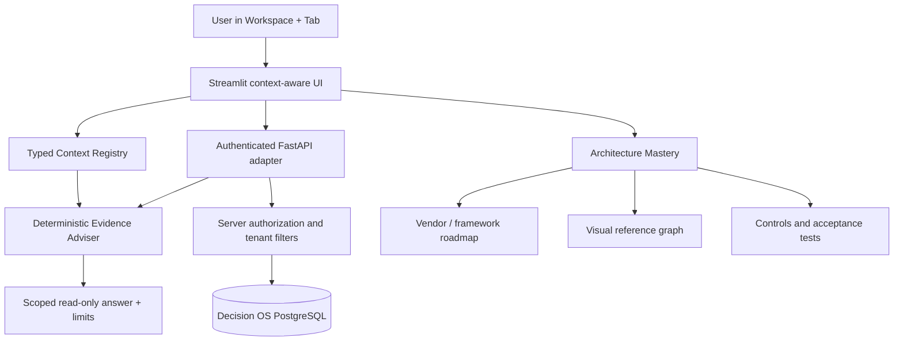

# Decision OS — Context-aware Copilot and Architecture Mastery

## High-Level Design (HLD)

### Boundaries
- `ui/context_copilot.py`: context registry and deterministic, read-only answerer. No agent tool execution.
- `ui/architecture_mastery.py`: framework-specific learning plans, implementation architecture, fixed Graphviz visualization, download.
- `ui/strategic_twin.py`: four tab-specific copilot instances. Existing scenario mathematics untouched.
- `ui/app.py`: route Architecture Mastery and render the correct page-specific copilot; existing standalone enterprise-wide Decision Copilot remains.
- Backend API retains all authN/authZ; UI is not a security boundary.

## Low-Level Design (LLD)

**Request flow:** `workspace, tab` → `resolve()` → `Context` (purpose, suggested questions, evidence controls) → `answer(query, Context, optional API context)` → scoped explanation or refusal.

**Context is explicit:** Streamlit tabs don't reliably expose their active state to an unrelated global footer. The Strategic Twin renders its adviser *inside each tab*. Other workspaces use page-level context, with additional tabs adopting the same one-line `render()` pattern as they are integrated. This avoids falsely claiming active-tab detection across the whole product.

**Deterministic arithmetic:** `Decimal` for explicitly supported `% of` operations. No Python `eval`, no unrestricted SQL or code generation, no LLM actions.

**Architecture Mastery:** five blueprints: Microsoft CAF / Responsible AI, AWS Well-Architected / Responsible AI Lens, Google SAIF / evaluation, NIST / OECD, LangGraph / Ollama. Every blueprint pairs roadmap, controls, tests and references. Fixed-source Graphviz ensures no user-input DOT injection.

**Security controls:**
1. Bearer token handled by existing app adapter, not passed through chat prompts.
2. Adviser is read-only and never marks evidence verified.
3. Server remains responsible for object-level tenant isolation and scoped retrieval.
4. No secret-bearing evidence is added to an LLM context in this increment.
5. Limit text length and add input validation server-side before future LLM expansion.
6. Before agent tool access, add Pydantic schemas, per-tool RBAC/ABAC, token audience, audit events, red-team tests and fresh policy checks.

**Accuracy:** The adviser reports only conditional guidance, mathematical identities and optionally API-reported next actions. It does not retrieve verified claim-level source evidence; consequently do not advertise 'zero hallucination' or a verified RAG system. Inaccurate or outdated framework details must be versioned and reviewed regularly.

## Review of uploaded proposed Apple-grade Strategic Twin

The supplied source is a useful *design reference*, not a drop-in verified platform implementation:

- Its demo graph calls some illustrative vendor dependencies 'verified' and cites sources not accessible in the supplied file: downgrade to scenario-only until authenticated evidence references exist.
- The triangular Monte Carlo calculation for a **negative** base makes `low` greater than `high`; risk of incorrect sign handling, reversed distribution explanations, and mislabeled percentile direction. Use `low=min(a,b), high=max(a,b)` and define benefit/cost sign conventions before percentiles.
- It presents negative modeled values as positive absolute 'cost reductions', making comparisons harder to audit; use an explicit sign, unit, currency, and common period.
- Several HTML strings are interpolated with `unsafe_allow_html=True` without escaping (e.g., descriptions), creating an XSS risk if later connected to user/API records. Use `html.escape` or native Streamlit widgets.
- `datetime.utcnow` creates naive timestamps; prefer UTC-aware timestamps and show observation dates and source-specific staleness.
- The 'verified' simulation sources and `Last reviewed: now()` imply fresh verification when no review occurred. Preserve actual, recorded review timestamps.
- Client-side authorization checkboxes are teaching aids, not security controls.
- The word 'causal' must be supported by a valid identification strategy, not merely a dependency chain.

The packaged delta extends the last running Decision OS Twin UI rather than overwriting it with this unreviewed attachment.

## Verification and validation

**Passed locally:** 9 pure unit tests; static `compileall`; existing authorization integration not retested against a running deployment.

**Before production:** backend integration tests, JWT/tenant crossover tests, user-entered XSS and prompt injection tests, browser test for all tabs and navigation, design contrast / WCAG 2.2 AA, performance under 100+ sessions, audit log schema validation, and independent control review.
