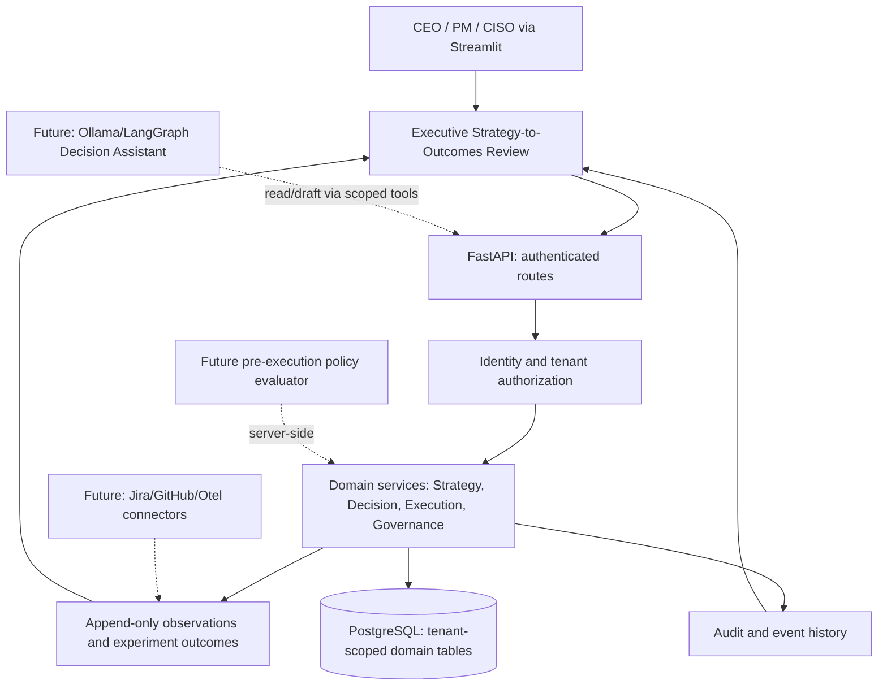

# Decision OS: Executive Strategy-to-Outcomes Review — Master HLD / LLD

**Status:** Implemented UI increment for existing R5.5 baseline. R5.6–R8 below is a **design and delivery roadmap**, not functioning code supplied in this package.

## 1. Product intent and capability boundary

The executive starts with questions: *Are we winning? Which outcomes lack evidence? What decisions need attention? Which assumptions are invalidated?* The flagship review tells one strategy-to-outcome story using existing tenant-scoped FastAPI resources. It does not create a second decision engine or overwrite an existing business workflow.

The navigation retains every existing specialist workspace. The flagship screen is read-only; it sends no policy approvals, spend authorizations, or commands to external systems. No unverified model output is treated as an audited return or causal inference.

## 2. High-level architecture (HLD)

**Current trust boundary:** browser/Streamlit to authenticated FastAPI; only backend may enforce tenant access and authorization. UI restrictions are affordances, not security boundaries. Browser-facing Streamlit session tokens are development bootstrap identity credentials; production needs per-person OIDC/Entra and explicit actor/delegation attribution.

**Current stack:** Streamlit UI → FastAPI → SQLAlchemy → PostgreSQL. Only the UI file changes in this delivery.

## 3. Low-level design (LLD) for delivered change

**Changed artifact:** `ui/app.py` only.

**Route:** navigation page `Strategy-to-Outcomes Review`, first item in the Overview domain.

**Read-only data dependencies:**

| API | Purpose | Absence behavior |
|---|---|---|
| `/v1/strategy/focus-areas` | Priority selection | Show explicit setup guidance |
| `/v1/strategy/objectives` | Parent-child objective filter | Show missing-link notice |
| `/v1/strategy/key-results` | Target, observation, freshness | Show missing outcome contract |
| `/v1/strategy/decision-links` | KR → decision linkage | Show link gap |
| `/v1/intelligence/decisions` | Authorized decision summary | No invisible cross-tenant inference |
| `/v1/execution/tasks` | Execution state | Never implies KR achievement |
| `/v1/strategy/assumptions` | Confidence, validation | Unknown ≠ supported |
| `/v1/strategy/experiments` | Predeclared test result | Never invent evidence |
| `/v1/decisions-governed/packets` | Human review queue | No automatic approval |

The UI consumes backend-supplied KR `measurement.state`: `STALE`, `NO_DATA`, `IN_PROGRESS`, `TARGET_MET_OBSERVED`. It **never** turns `TARGET_MET_OBSERVED` into “business value verified.” Decision tasks remain execution facts, not measurement facts.

**Data flow:** selected focus → filtered objectives → filtered key results → matching strategy decision links → permitted decision rows → linked tasks, assumptions and experiments → deterministic narrative and action links.

**UI behavior:** controlled selects, cards, table of observations/attention, expanders for decision lineage, deterministic executive briefing, buttons navigating to Strategy & Outcomes / Action Center / Replay. Existing detailed pages unchanged.

## 4. Security and AI safety design constraints

- **Identity:** API authenticates every request; production upgrade requires identity provider JWT signature/issuer/audience verification, short-lived sessions, and token revocation.
- **Authorization:** tenant predicates on reads and writes; explicitly test cross-tenant IDs, including guessed IDs, links, and errors. Verify object-level permissions; never use a browser-selected tenant as authority.
- **Separation of duties:** packet creator cannot self-approve; reviewer role derived from signed identity. Approval must bind actor, exact packet version and evidence snapshot. Production implementation must also prevent same-human dual control across service identities.
- **Double policy evaluation:** propose/review policy context, then re-evaluate immediately before any real side effect; a changed version or denial blocks execution. This is **not implemented** by this read-only UI.
- **LLM/tool boundary:** retrieved documents, chat messages and connector content are untrusted. Future assistant uses explicit intent and tool schemas, bounded retrieval, scoped service access and server-side validation. Never allow text to mint identity, approve spending or override policy.
- **Output integrity:** no made-up values, provenance attached to all claims, self-reported vs verified outcome clearly separated, uncertainty and confounding factors displayed.
- **Secret handling:** do not log OAuth tokens, raw private prompts or PII-rich evidence. At-rest TLS/cloud encryption and data residency need operational configuration.
- **Framework mapping:** design aligns with NIST AI RMF governance/measurement intentions, NIST SSDF and zero-trust principles, OWASP LLM application threat classes, and EU AI Act risk assessment concerns. **This release is not a conformity assessment or certification.** Legal obligations and applicability require jurisdiction-specific review.

## 5. SOLID / hexagonal decomposition for future backend releases

- `DecisionRepository`, `ObservationRepository`, `EvidenceRepository`, `PolicyRepository`: narrow storage ports.
- `ReviewAssembler`: deterministic cross-entity evidence fetch, authorization scoped.
- `OutcomeEvaluator`: typed units, freshness, baseline/target and attribution limitations.
- `ActionPacketFactory`: draft creation with source references and immutable snapshot ID.
- `PolicyEvaluator`: pure decision service, versioned policy input/output, deny by default.
- `HumanApprovalService`: identity-bound authorization and separation of duties.
- `RestrictedExecutor`: least-privilege allowlisted capabilities, idempotency and last-mile re-evaluation.
- `AssistantOrchestrator`: optional Ollama/LangGraph intent resolution and evidence-grounded drafts. **No direct DB writes or unreviewed actions.**

Keep small interfaces, pure domain calculations, orchestration apart from transport, and storage adapters apart from business policy. Do not make a single multipurpose agent class.

## 6. Release roadmap and quality gates

| Release | Deliverable | Mandatory gates |
|---|---|---|
| **Current UI increment** | Signature Strategy-to-Outcomes Review | compilation, existing R5.5 tests, browser review, no schema change |
| **R5.6** | Read/draft Decision Assistant (optional local Ollama) | context citations, prompt-injection evals, deny-by-default tools, cost/latency/failure metrics, per-person auth |
| **R6.0** | Jira, GitHub, OpenTelemetry/Prometheus adapters | account allowlists, sync backoff/idempotency, metric unit contracts, provenance, partial failure, secret rotation |
| **R6.1** | Decision Graph (derived links, not another truth store) | multi-tenant graph traversal, versioning, cycle limits, provenance |
| **R6.2** | Enterprise Memory and learning | evidence quality, recall precision, retention/privacy, historical-as-of replay |
| **R7** | Decision Twin | budget feasibility tests, uncertainty, constraints, stress tests, human sign-off |
| **R8** | Governed agent tools | formal permitted action classes, eval gates, SoD, action hash, pre-exec policy gate, rollback/kill switch |

## 7. Cloud and scale blueprint (not deployed here)

Production target: containerized UI/API behind ingress; managed PostgreSQL with point-in-time recovery; object store for immutable evidence versions; secret manager; identity provider; OpenTelemetry traces, metrics, logs; background connector workers behind queue with retry/DLQ; horizontal API scaling after idempotency and state externalization. Kubernetes deployment can target AKS, EKS or GKE with environment-specific manifests or Helm/Kustomize, NetworkPolicy, dedicated workload identity, resource quotas, PodDisruptionBudgets, readiness/liveness probes, non-root filesystem, signed images and admission policy.

Avoid prematurely adding Kafka, service meshes, and distributed vector databases without load measurements. Test cardinality, p95/p99 latency, tenant isolation, concurrency, query/index plans, restore drills, rate limiting, agent cost caps and incident response before “hyperscale” claims.

## 8. Verification performed and remaining

- `python -m py_compile ui/app.py`: compile check.
- `python -m pytest -q tests/test_strategy_r55.py`: 2 passed in isolated local development tests.
- Browser/Docker/PostgreSQL/Kubernetes and cloud deployments: **not executed here**.
- Final acceptance in user environment: back up the original UI, replace UI file, rebuild UI only, inspect rendered flow, test empty and populated tenant, switch reviewer identity using real credentials, confirm specialist navigation is intact, validate stale KRs, and compare with source records.

## 9. Prioritized product KPIs

Time to answer executive questions, weekly active executive reviewers, % Decisions with linked KRs, % KRs with recent observations, % observations with independently validated methodology, median approval latency, % invalidated assumptions caught before funding, decision-review preparation time, and audited value realized. Define denominators and track baseline before claiming improvement.
